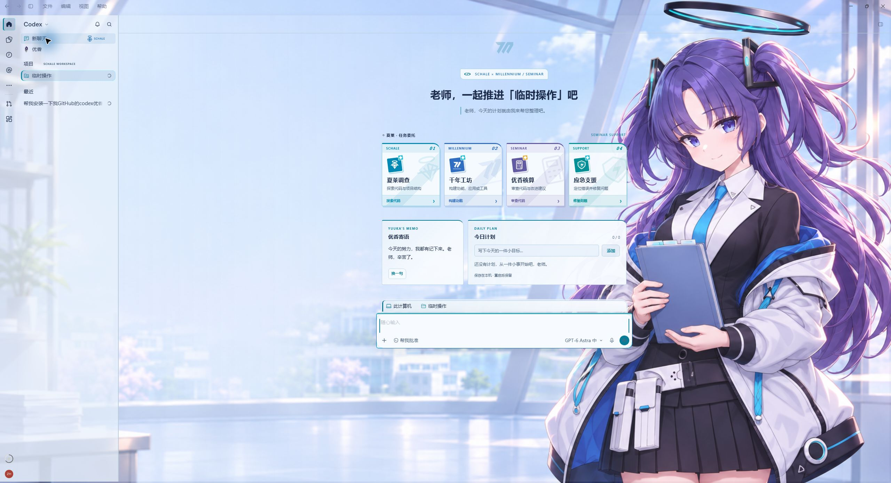

# Codex Dream Skin · Yuuka

[中文](README.md) · [Usage and migration (Chinese)](YUUKA-README.md)

A Yuuka / Blue Archive fan theme for Windows Codex Desktop, based on [the Internet Angel fork](https://github.com/EmiyaKatuz/Codex-Dream-Skin-Needy-Girl-Overdose).

**v1.9.2 · First Yuuka release** · [Downloads and checksums](https://github.com/longly-boat/Codex-Dream-Skin-Yuuka/releases/tag/v1.9.2) · [Release notes](docs/releases/v1.9.2-en.md) · [Report an issue](https://github.com/longly-boat/Codex-Dream-Skin-Yuuka/issues)

> This is a **pure vibe coding project**: the Yuuka customization and fixes were implemented mainly with AI assistance, and some rough edges may remain. Sorry if you run into a bug. Please share reproduction steps and your Codex and theme versions in [Issues](https://github.com/longly-boat/Codex-Dream-Skin-Yuuka/issues) so we can improve it.

## Special thanks to the Internet Angel project

**Our special thanks go to the maintainers and contributors of [EmiyaKatuz/Codex-Dream-Skin-Needy-Girl-Overdose](https://github.com/EmiyaKatuz/Codex-Dream-Skin-Needy-Girl-Overdose). Yuuka is a derivative of their openly shared code and design work.**

Their theme injection engine, package and Safe CSS validation, Windows installer and automatic takeover mechanism, motion framework, tray and native theme manager provide the foundation. Their home cards and themed interface also informed this version. Our additions focus on Yuuka artwork, Blue Archive visuals, the home workspace, compatibility fixes, and an independent installation and update identity.

We also thank the earlier [Fei-Away/Codex-Dream-Skin](https://github.com/Fei-Away/Codex-Dream-Skin) project and its contributors. Original copyright notices and licenses are retained. See [credits and sources](CREDITS.md).

## Features

- A light Yuuka default and a dark Night Accounting preset.
- Blinking, subtle hair movement and an animated Millennium emblem on Home; plain-color conversation pages.
- Four themed task cards: Schale Investigation, Millennium Workshop, Yuuka Accounting and Emergency Support.
- Native projects as Workspace, Yuuka messages, and a local daily checklist with add, complete and delete controls. Plans survive app restarts.
- Tray controls, native theme management, ZIP imports, transparency and motion settings, and automatic takeover of the original Codex launch entry.
- Separate installation, data and update identities. The upstream `dreamskin://` protocol remains untouched.

## Installation

Requires Windows 10 or later, x64, and the Microsoft Store version of Codex installed and successfully launched at least once. The installer bundles Node.js; normal use does not require a separate Node.js installation or .NET SDK.

1. Get `CodexDreamSkinYuuka-Setup-v1.9.2.exe` and `SHA256SUMS.txt` from [the v1.9.2 Release](https://github.com/longly-boat/Codex-Dream-Skin-Yuuka/releases/tag/v1.9.2). Verify the checksum before running Setup.
2. Open **Codex Dream Skin Yuuka**, apply the theme and optionally enable automatic takeover. You can keep using the original Codex taskbar icon; takeover still restarts Codex once.
3. When migrating an earlier custom installation, disable its watcher and restore the original appearance first. See the [English release and migration notes](docs/releases/v1.9.2-en.md) or the [full Chinese usage and source-build guide](YUUKA-README.md).

The v1.9.2 installer is **not code-signed**. Windows may display an unknown-publisher or SmartScreen prompt; runtime validation does not provide a publisher signature. Check the repository Release source and checksum. Do not update Yuuka with the upstream installer.

This release channel ships Windows only. The inherited macOS/Linux sources and shared assets remain in the repository, but their default themes, product identities and updaters are not supported Yuuka distributions.

## Matching Yuuka companion

[Add the shared pet](https://chatgpt.com/s/sharepet_6af711e160f88191a4508c5d0af094b2) · [Source, assets and instructions](pets/yuuka/README.en.md) · [Download pet v1.0.0](https://github.com/longly-boat/Codex-Dream-Skin-Yuuka/releases/tag/yuuka-pet-v1.0.0)

Nine animation states, sixteen look directions, and an idle loop with breathing, blinking and a shy collar touch. The complete transparent atlas, editable PNG, retained idle prompts and standalone tooling are public. Add the pet separately through your account's Pets feature; it is not installed by the Windows theme Setup.

## Sources and license

Code retains the upstream [MIT license and copyright notice](LICENSE). Artwork is AI-generated fan art; character and game marks belong to their respective owners and are not licensed by the code license. This is not an official OpenAI, NEXON or NEXON Games product.

Account-specific desktop pets are not included in the installer. The daily checklist is local data, not a cloud task list or a Codex goal.
