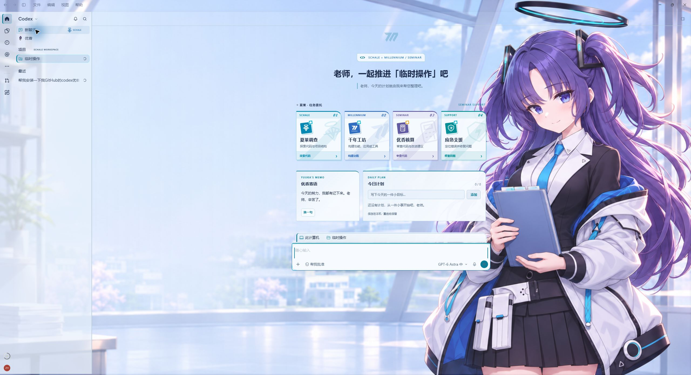

# Codex Dream Skin · 优香

[English](README.en.md) · [使用与迁移说明](YUUKA-README.md)

为 Windows Codex Desktop 制作的优香 / 蔚蓝档案同人主题，基于 [Codex Dream Skin 超天酱版](https://github.com/EmiyaKatuz/Codex-Dream-Skin-Needy-Girl-Overdose)。

**v1.9.2 · 优香版首发** · [下载与校验文件](https://github.com/longly-boat/Codex-Dream-Skin-Yuuka/releases/tag/v1.9.2) · [版本说明](docs/releases/v1.9.2.md) · [反馈问题](https://github.com/longly-boat/Codex-Dream-Skin-Yuuka/issues)

> 这是一个**纯 vibe coding 产物**：优香版的定制与修复主要通过 AI 辅助实现，仍可能有遗漏。如果遇到 bug，先向你说声抱歉；欢迎在 [Issues](https://github.com/longly-boat/Codex-Dream-Skin-Yuuka/issues) 提供复现步骤、Codex 与主题版本，帮助继续改进。

## 特别感谢：超天酱主题项目

**特别感谢 [EmiyaKatuz/Codex-Dream-Skin-Needy-Girl-Overdose](https://github.com/EmiyaKatuz/Codex-Dream-Skin-Needy-Girl-Overdose) 的维护者与贡献者。优香版是在他们公开的代码和设计基础上继续开发的衍生版本。**

我们沿用了上游的主题注入引擎、主题包与 Safe CSS 校验、Windows 安装及自动接管机制、动效框架、托盘与原生主题管理器，也参考了他们的首页卡片和界面主题化设计。优香版主要补充角色素材、蔚蓝档案视觉、首页工作台、相关兼容修复，以及独立的安装与更新身份。感谢他们把这些基础能力开放出来，让这个主题得以实现。

同时感谢更早的 [Fei-Away/Codex-Dream-Skin](https://github.com/Fei-Away/Codex-Dream-Skin) 与其他上游贡献者。保留原有版权、MIT 许可证及素材来源说明；详见 [致谢与来源](CREDITS.md)。

## 功能

- 默认优香浅色主题，内置深色「夜间核算」预设。
- 首页壁纸眨眼、发丝微动和千年徽记动效；聊天页使用背景色。
- 夏莱调查、千年工坊、优香核算、应急支援四张任务卡。
- 原生项目 Workspace、优香寄语、支持添加/勾选/删除的今日计划；清单保存在当前 Codex 本机应用数据中，重启后保留。
- 独立托盘、主题管理器、ZIP 导入、透明度与动态设置、原版任务栏入口自动接管。
- 使用独立安装目录、数据目录和更新仓库，不占用原版的 `dreamskin://` 协议。

## 安装

需要 Windows 10 或更高版本、x64，以及已安装并成功启动过的 Microsoft Store 版 Codex。安装器内置 Node.js，日常使用无需另装 Node.js 或 .NET SDK。

1. 从 [v1.9.2 Release](https://github.com/longly-boat/Codex-Dream-Skin-Yuuka/releases/tag/v1.9.2) 获取 `CodexDreamSkinYuuka-Setup-v1.9.2.exe` 和 `SHA256SUMS.txt`，核对摘要后运行安装器。
2. 打开 **Codex Dream Skin Yuuka**，应用主题并按需开启自动接管。开启后仍可使用原版 Codex 任务栏入口；接管会重启一次 Codex。
3. 从此前定制版迁移时，先停用旧版自动接管并恢复原生外观，再安装优香版。详见 [使用、迁移与源码构建](YUUKA-README.md)。

v1.9.2 安装器**未做代码签名**，Windows 可能显示未知发布者或 SmartScreen 提示；这与运行时校验不是一回事。请核对本仓库 Release 来源和摘要，不要用上游安装包更新优香版。

首发通道仅发布 Windows 包。仓库保留 macOS/Linux 上游代码与共享资源，但其默认主题、安装身份和更新器尚未完成优香版适配，不作为本次支持平台。

## 配套优香桌宠

[直接添加桌宠](https://chatgpt.com/s/sharepet_6af711e160f88191a4508c5d0af094b2) · [源码、素材与使用说明](pets/yuuka/README.md) · [下载桌宠包 v1.0.0](https://github.com/longly-boat/Codex-Dream-Skin-Yuuka/releases/tag/yuuka-pet-v1.0.0)

包含 9 种动作、16 个视线方向，以及呼吸、眨眼、歪头轻触衣领的新版待机。完整透明图集、可编辑 PNG、待机提示词和独立构建工具现已公开。桌宠通过账号中的 Pets 功能单独添加，不包含在 Windows 主题安装器中。

## 来源与许可

保留上游 MIT 代码许可证与作者声明，见 [LICENSE](LICENSE)。壁纸为 AI 生成的同人图；角色、游戏名称和相关标识归各自权利人，代码许可证不授予这些角色或素材的权利。此项目不是 OpenAI、NEXON 或 NEXON Games 的官方产品。

独立桌宠依赖 Codex 账号中的桌宠功能，不包含在此 Windows 主题安装包中。今日计划仅保存在本机，不是云端任务或 Codex 目标。
