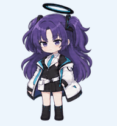
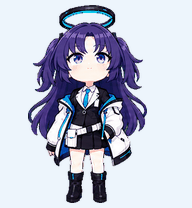
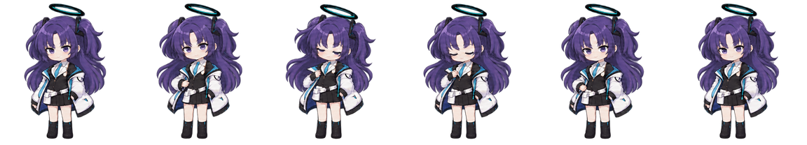

# Yuuka companion · v1.0.0

[中文](README.md) · [Theme repository](https://github.com/longly-boat/Codex-Dream-Skin-Yuuka) · [Add the shared pet](https://chatgpt.com/s/sharepet_6af711e160f88191a4508c5d0af094b2) · [Download the complete package](https://github.com/longly-boat/Codex-Dream-Skin-Yuuka/releases/tag/yuuka-pet-v1.0.0)

The independent Yuuka / Blue Archive companion that accompanies this theme. This package includes the current complete atlas, editable PNG, row mapping, retained idle-refinement prompts, previews and standalone tooling. Pet asset versions are separate from theme installer versions.





The six-frame idle moves from rest through a half-raised hand, a shy collar touch and head tilt, a blink, and back to rest, with breathing and hair follow-through. Preview backgrounds and timings are illustrative. The actual atlas is transparent; the host application controls playback.

## Use

Open the shared-pet link and follow the page to add and select your own copy. Your account and app must support Pets. The theme engine is not required.

For manual import or editing, download `Yuuka-Pet-v1.0.0.zip` from the pet release and use `spritesheet.webp`. You can also attach it in a Pets-enabled Codex / ChatGPT session and ask the assistant to validate it and create your own companion. Do not copy this folder over application files: `manifest.json` describes this package, not an account pet record.

The Windows theme Setup does not install or select account pets. No theme reinstall is needed for this asset release.

## Contents and layout

- `spritesheet.webp`: transparent 1536×2288 v2 atlas, eight columns and eleven rows of 192×208 cells.
- `source/spritesheet.png`: complete editable source with identical decoded pixels.
- `manifest.json`: public metadata, row mapping and sixteen look directions.
- `prompts/`: retained idle-refinement prompts, not the full original generation history.
- `previews/`: GIFs, contact sheet and idle stills rendered afresh from the final atlas.
- `build.py`, `requirements.txt`: standalone lossless encoding and preview tools.
- `validation.json`, `SHA256SUMS.txt`: structural validation results and package checksums.

| Zero-based row | State | Frames |
| --- | --- | ---: |
| 0 | idle | 6 |
| 1 | running-right | 8 |
| 2 | running-left | 8 |
| 3 | waving | 4 |
| 4 | jumping | 5 |
| 5 | failed | 8 |
| 6 | waiting for input or approval | 6 |
| 7 | running / processing work | 6 |
| 8 | review | 6 |
| 9–10 | look directions | 16 |

There are 73 populated cells and 15 transparent unused cells. Look angles advance clockwise in screen coordinates from up (0°), through right (90°), down (180°) and left (270°), in 22.5° steps. The old seven-frame local-player experiment is not included.



[All-state contact sheet](previews/contact-sheet.png) · [Idle–jump–idle loop](previews/idle-jump-idle.gif)

## Edit and rebuild

Requires Python 3.10+, preferably in a virtual environment. Run from this package directory: enter `pets/yuuka` in a clone, or the extracted package directory after downloading the ZIP.

```sh
python -m pip install -r requirements.txt
python build.py --check
python build.py --output /path/to/new-output-directory
```

On Windows, an output such as `D:\YuukaPetBuild` also works. The output directory must not exist; previous files are never overwritten. Edit the source PNG, then rebuild to produce a new WebP, manifest and previews. The tool does not access your account, network or application configuration.

The source PNG rebuilds identical pixels, although encoded bytes can differ across Pillow / libwebp versions. AI prompts do not deterministically recreate the artwork. `--check` validates checksums, occupied/transparent cells and PNG/WebP pixel equality; it does not replace platform validation or visual animation review. Validate modifications with the platform before importing. This release packages an existing companion without redrawing its retained states or newly certifying every state's visual semantics.

## Credits and license

**Special thanks to the maintainers and contributors of [the Internet Angel theme](https://github.com/EmiyaKatuz/Codex-Dream-Skin-Needy-Girl-Overdose)** and the earlier Dream Skin project for the matching theme's code and design foundation. The companion artwork is a separate addition. See [project credits](https://github.com/longly-boat/Codex-Dream-Skin-Yuuka/blob/main/CREDITS.md).

Code and documentation use the included [MIT license](LICENSE). Character fan artwork and third-party rights are excluded from that software grant; see [NOTICE](NOTICE.md).

This is a **pure vibe coding project**. Sorry for bugs or animation imperfections; please report your app version, pet asset version and reproduction steps in [Issues](https://github.com/longly-boat/Codex-Dream-Skin-Yuuka/issues).
